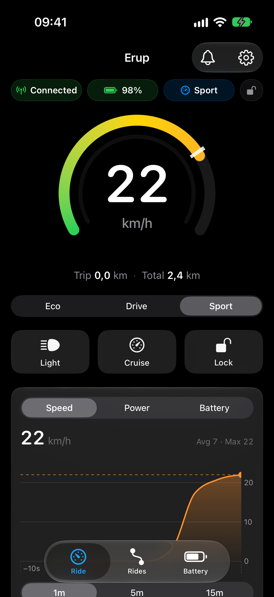
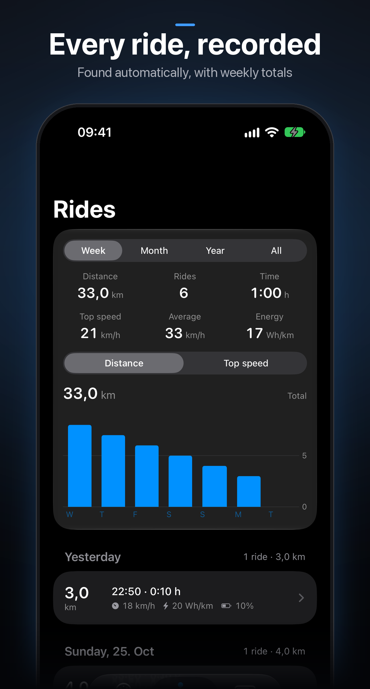
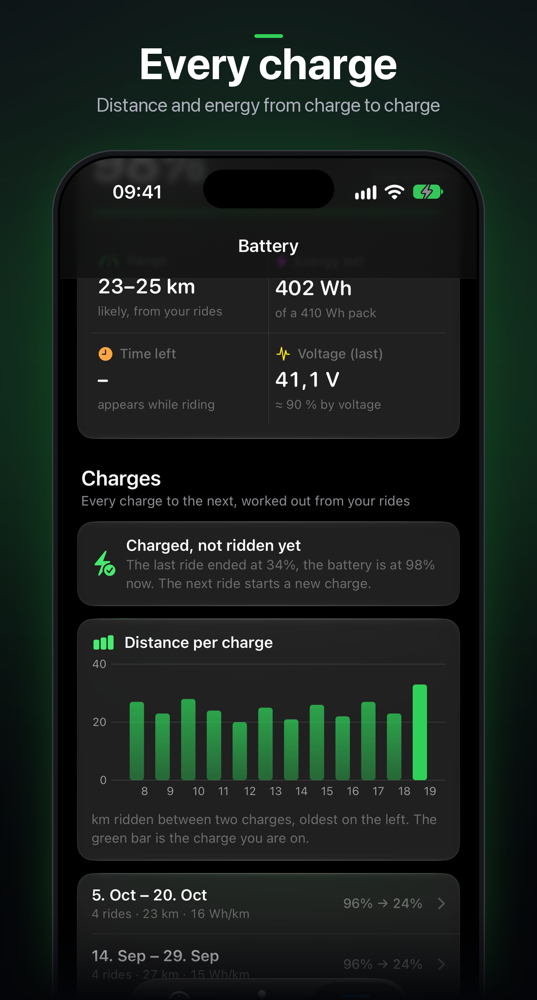
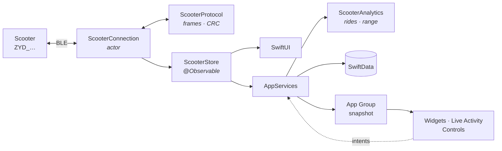

# Erup

**A fast, native iOS companion for the Pure Flex e-scooter: live dashboard, automatic rides, widgets and Live Activity. Pure spelled backwards.**


<a href="https://altstore.io/source/raw.githubusercontent.com/ouihq/Erup/main/source.json?app=me.ouihq.erup"></a>

<sub>Why the name? <b>Erup</b> is <b>Pure</b> spelled backwards.</sub>

[Install](#install) · [Features](#features) · [Safety](#safety) · [Your data](#your-data) · [Build](#building-from-source) · [Contributing](#contributing)

<p align="center">
  
  &nbsp;
  
  &nbsp;
  
</p>

Live speed and battery at a glance, rides that log themselves, widgets, a Live Activity and Control Center toggles, all over a Bluetooth link that reconnects on its own. Quick to open, quiet in the background, and fully usable with larger text and VoiceOver.

> [!NOTE]
> Independent project, not affiliated with Pure Electric. The Bluetooth protocol was reverse-engineered from a real scooter.

## ✨ Highlights

- **Live dashboard:** Speedometer with the gear's limit mark and room above it for downhill speed, regenerative braking, battery, range, gear, light, cruise and lock.
- **Rides that record themselves:** Distance, speeds, energy per kilometre, route on a map, and statistics for the week, month, year or all time.
- **Works without the scooter:** Rides, battery history and settings stay available. Live widgets show as unavailable instead of empty.
- **Private by design:** No account, no server, no analytics. Your PIN stays in the Keychain on your iPhone.
- **Your data stays yours:** Export any period as CSV, GPX and JSON, or reset the app completely.

##  📱 Compatibility

Erup is built and tested for the **Pure Flex**. It may also work with other Pure Electric models and scooters that use the same controller (they advertise as `ZYD_…`), but none of those are tested. Use it on another scooter with caution, and check that every control does what you expect while standing still before you ride.

Requires **iOS 18** or later. **iPhone only.**

## 🚀 Install

### AltStore

Tap the badge at the top, or add the source by hand in AltStore:

```
https://raw.githubusercontent.com/ouihq/Erup/main/source.json
```

Then open **Erup** in the source's list and tap **Get**. You can also download `Erup.ipa` from the [latest release](https://github.com/ouihq/Erup/releases/latest) and open it in AltStore. The IPA is unsigned on purpose; AltStore signs it with your own Apple ID.

<details>
<summary><b>Tips for a free Apple ID</b></summary>

| | |
|---|---|
| **Weekly refresh** | Apps signed with a free Apple ID expire after 7 days. AltStore refreshes them in the background while AltServer runs on your Mac or PC. |
| **App IDs** | Erup uses two: the app and its widget extension. A free account may register 10 new App IDs per week and run 3 sideloaded apps. When asked about extensions, choose **Keep App Extensions (Register App ID for Each Extension)**. |
| **Without extensions** | If you run out of App IDs, choose **Remove App Extensions**. The app itself works fully, but widgets, the Live Activity and the Control Center toggles are gone. |
| **App Group** | AltStore changes the App Group name when it signs the app. Erup reads the real name from the app, so widgets and the app still share data. |
| **LiveContainer** | Works for the dashboard, but there is no background Bluetooth, no widgets or Live Activity, and routes may be unavailable. A normal sideload is recommended. |

</details>

Prefer to build it yourself? See [Building from source](#building-from-source).

## 🌟 Features

| | |
|---|---|
| 🔌 **Always connected** | Restores Bluetooth after iOS suspends or kills the app and reconnects whenever the scooter is in range, without opening Erup. |
| 🏁 **Dashboard** | Speedometer, battery and range, gear picker, headlight, cruise and lock. Live speed, power and battery charts, regen, temperatures. |
| 🗺️ **Rides** | Detected automatically. Distance, duration, average and top speed, energy, Wh/km, battery used, optional GPS route, charts. Statistics by week, month, year and all time. |
| 🔋 **Range and battery health** | Range from *your* consumption with a learned pack capacity. Pack resistance from voltage sag, plotted over months. |
| 📱 **System integration** | Home and lock screen widgets, Live Activity and Dynamic Island, Control Center toggles, Siri and Shortcuts, notifications with an in-app notification center. |
| 🔐 **Lock and PIN** | Locks through the same register as the official app. The PIN is kept in the Keychain on this device only, with Face ID before it is shown or changed. |
| ♿ **Accessible** | Follows your text size, stacks layouts at the largest sizes, respects Reduce Motion, and describes its charts to VoiceOver. |

<details>
<summary><b>System integration in detail</b></summary>

| Surface | Content |
|---|---|
| Widgets | Battery, range, last seen, last ride (small, medium, lock screen circular, rectangular, inline) |
| Live Activity | Compact: battery and speed · Minimal: battery ring · Expanded: speed, battery, range, gear, trip, light |
| Control Center | Headlight and lock toggles |
| Siri and Shortcuts | "Turn on the scooter light", "Lock the scooter", "Scooter battery", "Set the scooter to eco" |
| Notifications | Low and critical battery, hot controller or motor, charge complete |

Widgets and controls only read a snapshot in the shared App Group. They never touch Bluetooth.

</details>

> [!IMPORTANT]
> The scooter's Bluetooth lock and PIN are not real security: anyone nearby can change the PIN without knowing the old one. Use a physical lock.

## 🔒 Safety

Enforced in code and covered by tests.

- **Speed caps are only echoed.** Every control frame carries the caps from the scooter's last limits frame, unchanged. Changing them would void road approval and insurance in Germany.
- **No firmware, flash or tuning code.** Speed limit, current, wheel and motor registers are never written.
- **One narrow write.** The only controller write is register 0 (the control word, for the lock), always built from a value just read back.
- **Standstill only.** Lock and cruise are refused above 1 km/h.
- **No guessed PINs.** Erup only sends the PIN you saved, because a wrong one makes the scooter drop the connection.

## 📊 Your data

| | |
|---|---|
| **Where it lives** | On your iPhone only. Rides and their sensor data are stored compressed and exactly as recorded. Settings → Data and storage shows the space used. |
| **Export** | Pick a period (all time, last 7, 30 or 90 days, last year, or a range) and what to include: ride list, sensor data, routes and one file per ride. You get a zip with CSV, GPX and JSON. The PIN is never included. |
| **Reset** | Settings → Data and storage → Reset Erup deletes every ride, forgets the scooter and removes the PIN and all settings. It asks for Face ID and a confirmation first. |
| **Notifications** | Problems and alerts are kept in the notification center, where you can remove them one by one or clear them all. |

## 🛠 Building from source

Needs Xcode 27.1+ and [XcodeGen](https://github.com/yonaskolb/XcodeGen).

```sh
git clone https://github.com/ouihq/Erup.git && cd Erup
xcodegen generate
open Erup.xcodeproj
```

Choose the **Erup** scheme, set your team and run. Run `xcodegen generate` again after adding or removing files. Set your team under *Signing & Capabilities* for **Erup** and **ErupWidgets**.

### No scooter? Use the simulator

The simulator uses a built-in mock scooter that produces real protocol frames. Add a launch argument to the scheme:

| Argument | Effect |
|---|---|
| *(none)* | A ride on loop |
| `-demo-parked` | Connected, standing still |
| `-demo-data` | A year of sample ride history |
| `-mock-ignore-writes` | The scooter never confirms, to see the rollback |
| `-live` | Real Bluetooth |

### Testing

```sh
swift test                                                                       # packages
xcodebuild -scheme Erup -destination 'platform=iOS Simulator,name=iPhone 17' test  # app
```

About 100 tests: CRC and capture vectors, fragmented and corrupted streams, bridge and AT replies, the speed-cap rule, ride detection and range, lock and cruise confirmation, optimistic updates and rollback, alerts, statistics, compression and export.

## 🔗 The AltStore source

[`source.json`](source.json) follows the [AltStore source format](https://faq.altstore.io/developers/make-a-source) and is read straight from the `main` branch. It lists the app, its permissions (they must match the IPA exactly) and every released version.

**Publishing a new version** (maintainers):

1. Raise `MARKETING_VERSION` (and `CURRENT_PROJECT_VERSION`) in [`project.yml`](project.yml), then build the unsigned IPA.
2. Run the script. It reads the version, build number and size from the IPA, so the source cannot disagree with the download:

   ```sh
   scripts/update-source.sh build/Erup-unsigned.ipa "What changed in this version"
   ```

3. Create a GitHub release named `v<version>` and attach the file the script prepared, `build/Erup.ipa`, with exactly that name.
4. Commit `source.json`. AltStore picks the change up the next time they refresh the source.

**The badge.** The "Download on AltStore" button at the top links to `https://altstore.io/source/<source URL without https://>?app=<bundle id>`, as described in the [badge instructions](https://faq.altstore.io/developers/download-on-altstore-badge). Its images live in [`docs/badges`](docs/badges). Add `&version=<version>` to link to one specific version.

## 🏗️ Architecture



- **`ScooterProtocol`**: pure Swift package, no CoreBluetooth. Frames, CRC-16/MODBUS, reassembly and resync, bridge mode, AT commands.
- **`ScooterAnalytics`**: pure Swift package. Ride detection, energy, sag estimate, range.
- **`ScooterConnection`**: actor owning CoreBluetooth. State restoration, reconnect with backoff, keep-alive, write flow control.
- **`ScooterStore`**: main-actor UI state, 10 Hz for the UI and about 1 Hz for widgets, rides and alerts.

<details>
<summary><b>Bluetooth protocol</b></summary>

| Service | Characteristics | Use |
|---|---|---|
| `F1F0` | `F1F1` write · `F1F2` notify | Binary telemetry and control frames |
| `F2F0` | `F2F1` write · `F2F2` notify | ASCII AT commands, e.g. `AT+PWD[123456]` |
| `180A` | `2A26` · `2A23` | Firmware revision, system ID |

After `a5 ff 00 00 00 00 00 5a` and a keep-alive (`a5 02 fd 5a`) every 300 ms, the scooter streams two 25-byte frames: live values (`ab 00 19 …`) and limits (`ab 01 19 …`). Control frames (`ab 00 0a …`) set gear, headlight, cruise and units. Bridge mode (`a5 00 ff …`) gives Modbus-style access to controller info and register 0, where the lock bit and cruise state are read and the lock is written. CRC-16/MODBUS, low byte first. The capture test vectors are in [`Tests/ScooterProtocolTests`](Tests/ScooterProtocolTests).

</details>

### Project layout

```
Sources/ScooterProtocol   Protocol: frames, CRC, decoder, bridge, AT
Sources/ScooterAnalytics  Rides, energy, sag, range
Tests/                    Package tests
App/Erup                  App: connection, store, services, rides, views
App/ErupWidgets           Widgets, Live Activity, controls
App/Shared                Snapshot, intents, commands (app and widgets)
App/ErupTests             App tests
scripts/                  update-source.sh keeps source.json in step with the IPA
docs/badges               Download on AltStore badge images
project.yml               XcodeGen definition
source.json               AltStore source
```

## ⚠️ Known limitations

- "Out of range" versus "switched off" is inferred from the disconnect reason, so it's a hint.
- iOS only starts a Live Activity from the foreground; a background connection shows it next time Erup opens.
- A Control Center toggle may run in the widget extension; it then hands the command to the app and waits for confirmation.
- Temperature thresholds and charge-complete detection are conservative estimates.
- The regenerative-braking gauge is scaled to about a third of the Flex's peak motor power, which is an estimate.

## 🤝 Contributing

**Missing a feature or found a bug?** [Open an issue](https://github.com/ouihq/Erup/issues/new). I work on them when I have time. If it involves your scooter's behaviour, a Bluetooth snoop log of the official Pure app doing the same thing helps a lot.

<details>
<summary><b>How to capture a Bluetooth log safely</b></summary>

1. Install Apple's [Bluetooth logging profile](https://developer.apple.com/bug-reporting/profiles-and-logs/?name=bluetooth) on your iPhone and restart it.
2. Open the Pure app, do the one thing you want supported, then close it.
3. Create a sysdiagnose and copy `bluetoothd-hci-latest.pklg` out of it (Settings › Privacy & Security › Analytics & Improvements › Analytics Data on the iPhone, or via Finder on a Mac).

> [!WARNING]
> A snoop log contains everything sent to your scooter, **including your lock PIN** (`AT+PWD[…]`) and its name and Bluetooth address. Before sharing, change the PIN to a throwaway value and back afterwards, or send the log privately instead of attaching it to a public issue. Never commit a log to the repository.

</details>

**Have an idea or a fix?** Pull requests are welcome. Please keep changes within the [safety rules](#safety): speed caps and limits are never changed. Run `swift test` and the app tests before opening one.

## 🙏 Acknowledgements

[ZydDash](https://github.com/Ennar1991/ZydDash) documents a related Zydtech controller and helped confirm the GATT layout, bridge frames, CRC order and lock bit.
